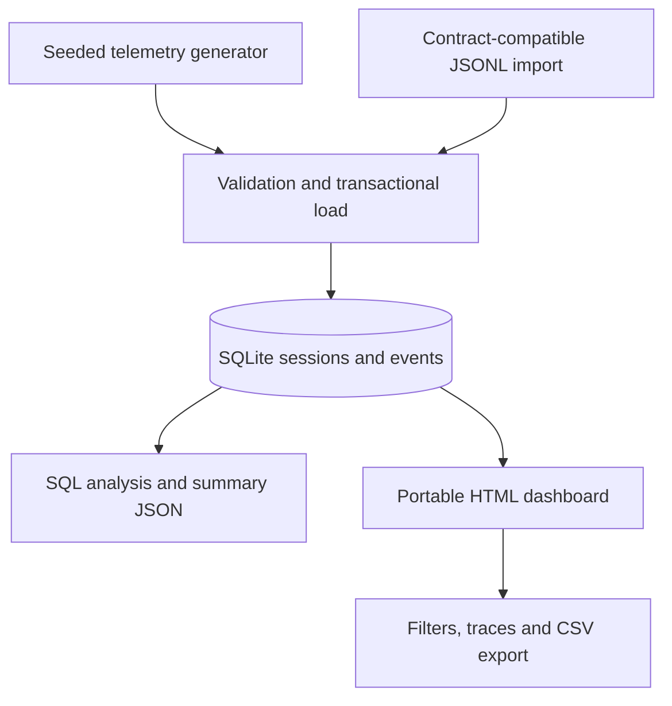

# Agent Observatory

**An AI agent observability portfolio project: trace what the agent did, measure reliability, and connect technical behaviour to user outcomes.**

Python · SQL / SQLite · JavaScript · Offline dashboard · Automated checks

**Six interactive views · Shared filters · Trace replay · CSV export**

> **Synthetic demonstration.** All telemetry is generated locally. No production agents, real users, paid APIs or actual business improvements are represented. Findings describe the simulator, not a customer deployment.

## Try it in 30 seconds

Download or clone the repository, then open **`dashboard/index.html`** in your browser. It already contains the complete demo dataset and works offline. No installation, API key or server is required.

To regenerate everything using Python 3.10 or newer:

```bash
# macOS / Linux
PYTHONPATH=src python -m agent_observatory.pipeline
PYTHONPATH=src python -m unittest discover -s tests -v
```

```powershell
# Windows PowerShell
$env:PYTHONPATH = 'src'
python -m agent_observatory.pipeline
python -m unittest discover -s tests -v
```

Alternatively run `make build`, `make test`, and `make serve`. The optional local server is available at http://127.0.0.1:8000.

**Runtime dependencies: Python standard library only.** The dashboard has no CDNs, frameworks, trackers or external requests.

## The operational question

A support agent searches knowledge, retrieves orders or updates account details. It can read memory, route to a tool chain, fail an API call, retry, update state, and produce an answer. Does a successful tool chain actually lead to the user completing their task?

The demo generates 1,200 sessions and 9,412 events over 30 UTC days. It deliberately includes a provider incident, a staged prompt release and user abandonment after technically successful responses.

## Explore six views

| View | Questions answered |
|---|---|
| Reliability overview | Are sessions reliable? Are users completing tasks? Which tools dominate activity? |
| Session trace explorer | What happened, in what order, with which attempt, latency and state transition? |
| Errors & retry recovery | Which tools fail? How many initially failed logical calls recover? |
| Prompt version comparison | How do version-labelled cohorts differ, including within task? |
| User outcomes | Where do completion, abandonment and follow-up differ? |
| Memory & routing | Which routes succeed? How is memory activity associated with completion? |

Every view shares date, prompt and task filters. There is a no-results state and filtered session CSV export. All metrics are recomputed for the selection. The trace explorer includes every event from the selected session, including failures later recovered by retry.

## Architecture



- `src/agent_observatory/generate.py`: deterministic support-agent simulation.
- `src/agent_observatory/pipeline.py`: validation, transactional import, database and dashboard export.
- `sql/schema.sql`: primary keys, foreign keys, constraints, indexes and logical-call view.
- `sql/metrics.sql`: inspectable analytical queries at attempt, call and session grain.
- `dashboard/template.html`: dashboard source; `index.html` is the generated runnable output.
- `data/`: generated session/event JSONL, summary and local SQLite output.
- `tests/`: metric reconciliation, import integrity, escaping and regression checks.
- `docs/`: metric dictionary, data contract, findings, interview notes and verification record.
- `.github/workflows/ci.yml`: Python checks and deterministic output drift check.

## What the data demonstrates

For the default seed, technical session success is **97.08%** but user completion is **84.33%**. Order API attempts have a **14.77%** error rate, the highest tool-level attempt error rate in the demo. These are generated outputs, not achieved improvements.

Use the error view and `order_status` filter to inspect 14–16 October. The generator explicitly increases failure probability and latency for `orders_api` on those dates. The presence of that cluster validates that the dashboard exposes the injected scenario; it is not an independently discovered production root cause.

Prompt v1.1 is assigned a lower baseline error probability and is available only from 8 October. Compare versions during overlapping dates and within task. Raw aggregate comparisons are confounded by release timing, traffic and the provider incident. No causal lift is claimed.

## Reproduce or import

```bash
PYTHONPATH=src python -m agent_observatory.pipeline --sessions 1200 --seed 42
# A different simulation:
PYTHONPATH=src python -m agent_observatory.pipeline --sessions 2500 --seed 7
# Import a directory with sessions.jsonl and events.jsonl:
PYTHONPATH=src python -m agent_observatory.pipeline --input /path/to/telemetry
```

Imports must match the documented **demo contract**, including closed sessions and at most two attempts per logical call. This is not a universal OpenTelemetry importer. Real telemetry requires a mapping and redaction layer. Rebuilding overwrites generated JSONL, summary, SQLite tables and `dashboard/index.html`; keep source inputs in a separate directory.

Query the generated database with the SQLite CLI or Python:

```bash
sqlite3 data/observatory.db < sql/metrics.sql
```

## Verification

15 Python/SQL tests and a dependency-free Node.js dashboard logic harness pass. The harness checks all six view render functions, metric values, recovery denominators, combined filters, empty state, reset, trace content, escaping and percentiles. Run it from the repository root with `node tests/dashboard_logic.cjs`.

Full browser interaction, CSV-download behaviour and desktop/mobile visual layout remain unverified: the authoring environment had no browser and the browser download failed. The delivered dashboard is functional code, but this is a real verification gap. See [verification notes](docs/verification.md).

## Honest scope

This is a batch analytics project, not a production monitoring service. It does not call an LLM, inspect hidden reasoning, stream traces, enforce SLAs, store prompt text, measure RAM, infer memory correctness, model concurrent spans, implement alert delivery, or estimate token costs. Memory state is a version counter. User actions are simulated, and user think time is excluded. Imports are embedded in the exported HTML: never share unredacted data.

A real deployment would add independent product outcome instrumentation, event-time watermarks, retention/redaction rules, consent controls, span hierarchies, alert evaluation, cost accounting, and controlled prompt experiments.

## Repository

Published at https://github.com/SanketCSakhare/agent-observatory.

Clone and open the dashboard:

```bash
git clone https://github.com/SanketCSakhare/agent-observatory.git
cd agent-observatory
```

Open `dashboard/index.html` locally. No GitHub Pages deployment is included or claimed.

## Portfolio wording

“Built a reproducible AI agent observability project using Python, SQLite and JavaScript; analysed 1,200 simulated sessions across tool reliability, retry recovery, prompt versions, memory activity and user completion, with filterable session traces and automated data-quality checks.”

See [metric definitions](docs/metrics.md), [data contract](docs/data-contract.md), [findings](docs/findings.md) and [interview notes](docs/interview-notes.md).

Concept inspired by the article supplied by the user, *Build an Observability Dashboard for AI Agents: A Portfolio Project That Shows Real Data Skills* (23 October 2026). Implementation and simulation are original to this project. No external dataset is used.

Code and generated demo data are released under the MIT licence.
